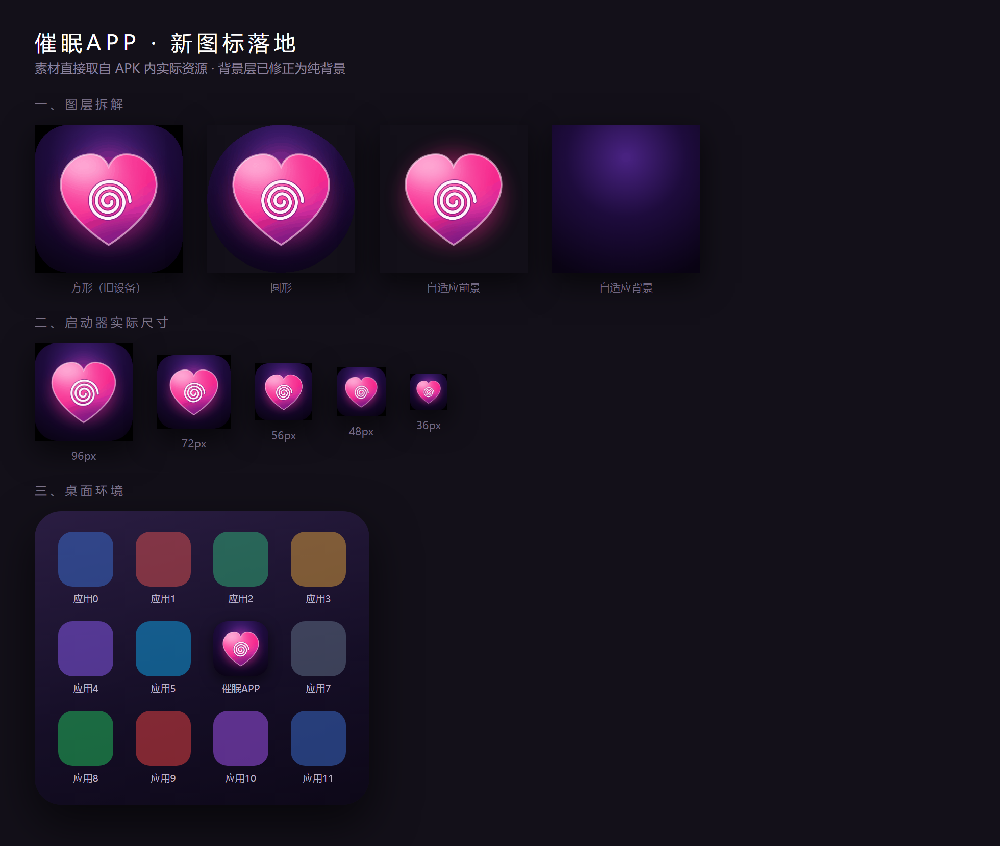

# 催眠APP (HypnoApp)

一个漫画风格的「催眠模拟器」小玩具。
**不包含任何真实的催眠功能**，全部是视觉演出。

<p align="center">
  
</p>

## 功能

首页分四个入口，设置完点「催眠开始」进入演出：

| 功能 | 说明 |
|---|---|
| **对象修改** | 决定被催眠的人**会变成什么样子**——性别、年龄、身高、体重、体形、气质分类、性格、发色、发型、瞳色、声线。顶部有实时「变身预览」 |
| **催眠** | 对 TA 施加催眠。可写一句台词、调诱导强度，或录一段假装语音 |
| **常识改写** | 把「理所当然」悄悄换掉 |
| **感觉调整** | 心情 · 敏感度 · 体温 · 心跳 |

演出层：中心一颗心蹦出来，随后心形一层层向外扩张并旋转，像理发店招牌那样铺满屏幕。

## 架构

```
Java 原生壳 ── 沉浸式全屏 · 震动反馈 · 屏幕常亮 · 返回键接管 · 刘海安全区注入
      │
      └─ WebView ── assets/ (HTML + CSS + JS)
```

Java 负责系统能力，CSS 负责视觉表现，所以动画表现力接近原生。

## 构建

需要 JDK 17 + Android SDK (compileSdk 36)。

```bash
./build.sh          # 输出 app/build/outputs/apk/release/app-release.apk
```

首次构建前请在 `local.properties` 里填好 `sdk.dir`，
并在 `app/build.gradle` 里替换成自己的签名配置。

## 技术参数

- minSdk 24 (Android 7.0) / targetSdk 34 / compileSdk 36
- 零第三方依赖
- APK 约 650 KB

## 项目结构

```
app/src/main/
├── java/com/hypno/app/MainActivity.java   原生外壳
├── assets/index.html                      界面结构
├── assets/style.css                       样式与动画
├── assets/app.js                          交互逻辑与演出时间轴
└── res/                                   图标资源（自适应图标，5 档密度）
```

## 免责声明

本项目仅供学习与娱乐，不产生任何实际催眠效果。
请勿用于未经他人同意的用途。

## License

MIT
